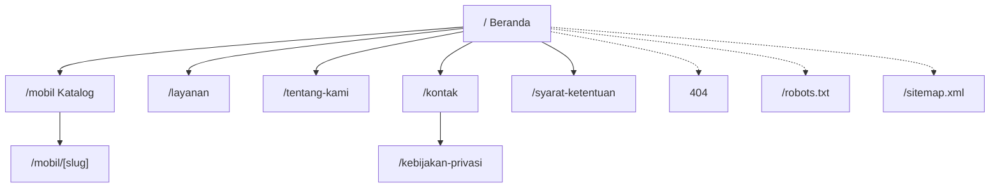
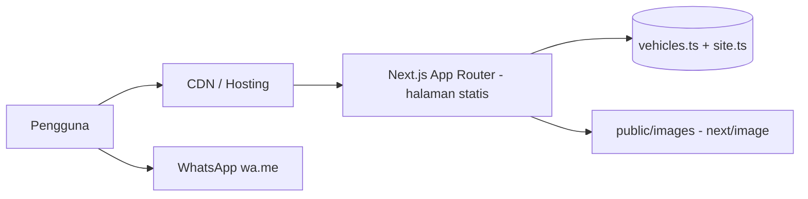

# PRD — Website Rental Mobil PT. MAULANA SADHA UTAMA

## 1. Metadata Dokumen dan Versioning

| Item | Isi |
|---|---|
| Nama dokumen | Product Requirements Document — Website Rental Mobil PT. MAULANA SADHA UTAMA |
| Nama file | PRD-MUL-RENT-CAR.md |
| Versi | 0.1 (Draft untuk ditinjau pemilik proyek) |
| Tanggal | 9 Oktober 2026 |
| Status | Draft — menunggu persetujuan pemilik proyek |
| Pemakai dokumen | Pemilik proyek, developer, AI coding agent (Antigravity) |
| Bahasa | Indonesia |
| Stack utama | Next.js (App Router), TypeScript, Tailwind CSS |

**Riwayat versi**

| Versi | Tanggal | Perubahan |
|---|---|---|
| 0.1 | 2026-10-09 | Draft awal berdasarkan master prompt dan data sumber dari pemilik proyek |

**Konvensi label**

- **[FAKTA]** — data yang diberikan pemilik proyek. Belum diverifikasi independen.
- **[ASUMSI]** — keputusan sementara agar perancangan bisa berjalan. Harus dikonfirmasi.
- **[REKOMENDASI]** — saran dari penyusun PRD.
- **[TERBUKA]** — pertanyaan yang butuh jawaban pemilik proyek (lihat Bagian 26).
- **[VERIFIKASI]** — ketentuan bisnis atau legal yang harus diperiksa pemilik sebelum dipublikasikan.

**Prioritas requirement:** P0 = wajib untuk MVP; P1 = sebaiknya ada di MVP; P2 = fase lanjutan.

---

## 2. Executive Summary

PT. MAULANA SADHA UTAMA (Medan, Sumatera Utara) adalah perusahaan jasa sewa mobil dengan layanan sewa dengan sopir, lepas kunci, perjalanan dinas/korporat, wedding car, Hiace, bus pariwisata, dan Request Order. Perusahaan belum memiliki kanal web yang profesional untuk membangun kredibilitas, menampilkan armada dan harga indikatif, serta menerima permintaan penawaran.

Produk yang dirancang adalah **website company profile + katalog armada + jalur konversi ke WhatsApp**. Website berfungsi sebagai etalase dan pintu masuk percakapan penjualan, bukan sistem booking.

**Keputusan utama MVP (ringkasan)**

| Keputusan | Pilihan |
|---|---|
| Dashboard admin | **Tidak masuk MVP.** Data katalog dikelola developer lewat berkas data TypeScript terstruktur [ASUMSI — lihat OQ-01]. |
| Booking online dan pembayaran | Tidak masuk MVP. |
| Ketersediaan real-time | Tidak masuk MVP. Ketersediaan selalu dikonfirmasi lewat WhatsApp. |
| Formulir penawaran | Masuk MVP. Formulir di sisi klien yang **menyusun pesan WhatsApp**, tanpa penyimpanan data di server. |
| Database | Tidak diperlukan di MVP. |
| Unggah dokumen identitas | Tidak ada. Persyaratan hanya ditampilkan sebagai informasi. |
| Hosting | Hosting Next.js yang mendukung deployment statis/SSG (mis. Vercel atau setara) [REKOMENDASI]. |

---

## 3. Problem Statement

1. Calon pelanggan (individu, keluarga, korporat, instansi, EO, hotel, travel) sulit membandingkan armada dan harga indikatif sebelum menghubungi perusahaan.
2. Tanpa website resmi, kredibilitas perusahaan di mata pelanggan korporat dan instansi lebih sulit dibangun dibanding mengandalkan media sosial saja.
3. Pesan masuk lewat WhatsApp sering tidak terstruktur (tidak menyebut armada, tanggal, durasi, rute), sehingga admin perlu bertanya ulang.
4. Informasi harga dan syarat tersebar dan berisiko tidak konsisten.
5. Perusahaan belum punya aset pencarian organik untuk kata kunci lokal seperti "rental mobil Medan".

---

## 4. Product Vision

> Website resmi PT. MAULANA SADHA UTAMA yang membuat calon pelanggan percaya, memahami layanan dan harga indikatif dalam hitungan detik, lalu menghubungi perusahaan lewat WhatsApp dengan pesan yang sudah terstruktur.

Selaras dengan visi dan misi perusahaan **[FAKTA]**:

- **Visi:** memberikan servis terbaik kepada pelanggan, menjadi perusahaan transportasi terdepan, menjadi mitra kerja yang dapat diandalkan sekarang maupun di masa depan, dan menjadi andalan dalam melayani perjalanan di berbagai kota di Indonesia.
- **Misi:** (1) memberikan solusi transportasi kepada mitra; (2) berusaha menyediakan kendaraan yang optimal dan terbaru; (3) membangun kinerja yang memuaskan untuk penyewa kendaraan.

---

## 5. Goals dan Non-Goals

### 5.1 Goals

| ID | Tujuan | Metrik | Jenis ukur |
|---|---|---|---|
| G-01 | Memperkenalkan perusahaan secara profesional | Halaman Beranda, Tentang Kami, dan Kontak tayang dengan seluruh konten disetujui pemilik | Dapat diukur saat peluncuran (checklist) |
| G-02 | Menampilkan armada dan harga indikatif terstruktur | 14 entri armada dari daftar harga tampil, harga di semua tempat sama dengan sumber data | Dapat diukur saat peluncuran (tes otomatis) |
| G-03 | Membantu pelanggan menemukan kendaraan | Pencarian, filter kategori, dan sorting berfungsi tanpa error | Dapat diukur saat peluncuran |
| G-04 | Menghasilkan pertanyaan lewat WhatsApp | Jumlah klik CTA WhatsApp per halaman/kendaraan; jumlah pengiriman formulir penawaran | **Baru terukur setelah analytics dipasang** |
| G-05 | Meningkatkan kepercayaan | Informasi kontak, alamat, syarat, dan profil lengkap dan konsisten | Checklist saat peluncuran; persepsi pelanggan baru terukur lewat survei/feedback |
| G-06 | Mendukung pencarian organik | Metadata, sitemap, robots, NAP konsisten, skor audit teknis (Lighthouse SEO) sesuai target | Audit teknis saat peluncuran; posisi/trafik organik **baru terukur setelah Search Console aktif** |
| G-07 | Katalog mudah diperbarui | Perubahan harga/kendaraan cukup di berkas data tanpa mengubah komponen UI | Dapat diukur saat peluncuran |

**Catatan:** dokumen ini tidak menjanjikan kenaikan konversi atau peringkat Google tertentu. Target kuantitatif konversi baru ditetapkan setelah ada data dasar (baseline) minimal 1–3 bulan.

### 5.2 Non-Goals (MVP)

- Booking online, pembayaran, dan invoice.
- Kalender ketersediaan real-time.
- Dashboard admin, multi-role, CRM, laporan keuangan.
- Unggah atau penyimpanan KTP, NPWP, buku nikah, atau dokumen identitas lain.
- Blog/artikel, multi-bahasa, akun pelanggan, review/testimoni (tidak ada data nyata).
- Kalkulator harga final berbasis rute/durasi.

---

## 6. Target Pengguna dan User Personas

Segmen **[FAKTA]**: perusahaan nasional/multinasional, instansi pemerintah, hotel, perbankan, event organizer, perusahaan travel, individu dan keluarga, serta pelanggan perjalanan dinas/acara/wisata.

Persona di bawah adalah **model kerja untuk perancangan**, bukan data riset. [ASUMSI]

| Persona | Kebutuhan | Hambatan | Yang dibutuhkan dari website |
|---|---|---|---|
| **P1 — Koordinator umum perusahaan/instansi** | Kendaraan dengan sopir untuk tamu atau dinas; sering butuh penawaran resmi | Perlu dasar harga dan kejelasan PPN/PPh | Daftar harga indikatif, catatan pajak, persyaratan perusahaan, tombol konsultasi korporat |
| **P2 — Keluarga/individu** | Mobil keluarga untuk liburan di Medan dan sekitarnya | Bingung memilih tipe, takut harga tidak jelas | Katalog sederhana, harga indikatif jelas, WhatsApp cepat |
| **P3 — Event organizer / travel agent** | Banyak kendaraan sekaligus, Hiace atau bus | Armada besar tidak punya harga di katalog | Layanan Hiace dan bus pariwisata, jalur konsultasi dan Request Order |
| **P4 — Calon pengantin / keluarga acara** | Wedding car dengan dekorasi | Tidak ada harga/foto di data | Penjelasan layanan, konsultasi WhatsApp |
| **P5 — Penyewa lepas kunci** | Menyetir sendiri | Persyaratan dokumen berat | Persyaratan lepas kunci yang jelas, harga berdasarkan penawaran |

---

## 7. User Journeys

### UJ-01 — Keluarga mencari mobil

1. Pengguna menemukan website lewat pencarian atau media sosial → Beranda.
2. Menjelaskan layanan dalam hitungan detik; menekan CTA "Lihat Armada".
3. Di `/mobil` mencari "Xpander" atau memfilter kategori MPV, mengurutkan harga.
4. Membuka `/mobil/xpander`, melihat harga indikatif, catatan harga, galeri.
5. Menekan "Tanyakan Ketersediaan" → WhatsApp terbuka dengan pesan terisi (armada, harga indikatif, placeholder tanggal/durasi/rute).
6. Pengguna melengkapi placeholder dan mengirim. **Booking baru dianggap terjadi setelah dikonfirmasi admin di luar website.**

### UJ-02 — Koordinator korporat

1. Beranda → "Layanan" → bagian "Perjalanan Dinas & Korporat".
2. Membaca persyaratan perusahaan di `/syarat-ketentuan`.
3. Menekan "Konsultasi Layanan Korporat" → WhatsApp dengan pesan layanan korporat.

### UJ-03 — Pelanggan mencari kendaraan yang tidak ada di katalog

1. Pengguna menelusuri `/mobil`, tidak menemukan kendaraan (atau hasil kosong).
2. Empty state menampilkan tombol "Request Order".
3. WhatsApp terbuka dengan template Request Order (nama kendaraan yang diminta, tanggal, durasi, rute).

### UJ-04 — Pengguna mengisi formulir penawaran

1. Buka `/kontak` → formulir "Minta Penawaran".
2. Mengisi nama, nomor telepon, layanan, tanggal, durasi, rute, catatan; validasi di klien.
3. Menekan "Kirim via WhatsApp" → WhatsApp terbuka dengan pesan tersusun. Tidak ada data disimpan di server.

### UJ-05 — Pengguna meninjau persyaratan

Pengguna membuka `/syarat-ketentuan`, memilih tab/bagian sesuai jenis (dengan sopir, lepas kunci, perusahaan), lalu menghubungi perusahaan untuk konfirmasi prosedur.

---

## 8. Functional Requirements

Format: **ID — Prioritas — Deskripsi — Kriteria penerimaan ringkas** (acceptance criteria rinci ada di Bagian 20).

### 8.1 Website Publik (FR-PUB)

| ID | P | Deskripsi |
|---|---|---|
| FR-PUB-001 | P0 | Situs terdiri dari halaman: Beranda, Katalog, Detail Kendaraan, Layanan, Syarat & Ketentuan, Tentang Kami, Kontak, Kebijakan Privasi, 404. |
| FR-PUB-002 | P0 | Navbar dan footer konsisten di semua halaman; navbar menyertakan CTA WhatsApp. |
| FR-PUB-003 | P0 | Tombol WhatsApp mengambang (floating) tampil di semua halaman publik, tidak menutupi konten penting di mobile. |
| FR-PUB-004 | P0 | Semua halaman responsif (mobile, tablet, desktop). |
| FR-PUB-005 | P0 | Tidak ada statistik, testimoni, logo mitra, atau review rekaan. Bagian tersebut tidak dibuat sampai ada data nyata. |
| FR-PUB-006 | P0 | Klaim "lebih dari lima tahun pengalaman" dan "jaringan 38 provinsi" ditampilkan sebagai pernyataan perusahaan [VERIFIKASI], tanpa angka tambahan. |

### 8.2 Katalog (FR-CAT)

| ID | P | Deskripsi |
|---|---|---|
| FR-CAT-001 | P0 | `/mobil` menampilkan semua kendaraan berstatus `published` dari sumber data tunggal. |
| FR-CAT-002 | P0 | Kartu kendaraan menampilkan foto (atau placeholder), nama, kategori, harga indikatif + satuan, dan tautan ke detail. |
| FR-CAT-003 | P0 | Pencarian teks pada nama dan alias kendaraan (case-insensitive, abaikan spasi/tanda hubung berlebih). |
| FR-CAT-004 | P0 | Filter kategori kendaraan. |
| FR-CAT-005 | P1 | Filter kisaran harga (opsi: ≤ Rp650.000, Rp650.001–Rp1.100.000, > Rp1.100.000) [ASUMSI — dapat disesuaikan]. |
| FR-CAT-006 | P0 | Sorting: nama A–Z, harga terendah, harga tertinggi, default "urutan tampil". |
| FR-CAT-007 | P0 | Tombol reset filter; jumlah hasil ditampilkan ("Menampilkan N kendaraan"). |
| FR-CAT-008 | P0 | Sinkronisasi pencarian/filter/sort ke query string (`?q=&kategori=&harga=&urut=`) agar dapat dibagikan; halaman terfilter memakai canonical ke `/mobil`. |
| FR-CAT-009 | P0 | Empty state: pesan jelas, tombol "Reset Filter", dan tombol "Request Order" ke WhatsApp. |
| FR-CAT-010 | P0 | **Tidak ada** filter kapasitas, transmisi, tahun, atau ketersediaan sampai datanya lengkap dan terverifikasi. |

### 8.3 Detail Kendaraan (FR-DET)

| ID | P | Deskripsi |
|---|---|---|
| FR-DET-001 | P0 | `/mobil/[slug]` dibuat statis (SSG) dari data; slug tidak dikenal → halaman 404. |
| FR-DET-002 | P0 | Menampilkan nama, kategori, harga indikatif + satuan + cakupan wilayah, badge "Harga indikatif", deskripsi, dan catatan harga. |
| FR-DET-003 | P0 | Galeri foto: gambar utama + thumbnail; navigasi keyboard; alt text; jika foto kosong, tampil placeholder bertuliskan "Foto segera tersedia". |
| FR-DET-004 | P0 | CTA utama "Tanyakan Ketersediaan" dan sekunder "Minta Penawaran" (keduanya WhatsApp dengan pesan kendaraan). |
| FR-DET-005 | P0 | Blok catatan harga: belum termasuk PPn/PPh, BBM, e-toll, parkir; dapat dinegosiasikan; harga hanya untuk layanan dengan sopir di Kota Medan dan sekitarnya; ketersediaan wajib dikonfirmasi. |
| FR-DET-006 | P1 | Bagian "Kendaraan lain" (3 entri terkait berdasarkan kategori). |
| FR-DET-007 | P0 | Spesifikasi (kapasitas, transmisi, fitur) hanya tampil bila datanya terisi dan terverifikasi; jika kosong, bagian disembunyikan, bukan diisi dugaan. |

### 8.4 Layanan (FR-SVC)

| ID | P | Deskripsi |
|---|---|---|
| FR-SVC-001 | P0 | `/layanan` menyajikan 7 layanan sebagai bagian-bagian dengan anchor (`#dengan-sopir`, `#lepas-kunci`, `#korporat`, `#wedding-car`, `#hiace`, `#bus-pariwisata`, `#request-order`). |
| FR-SVC-002 | P0 | Tiap layanan: deskripsi singkat, siapa yang cocok, informasi harga (indikatif/ berdasarkan penawaran), dan CTA WhatsApp yang spesifik layanan. |
| FR-SVC-003 | P0 | Layanan dengan sopir menautkan ke katalog dan menyebut harga indikatif harian untuk Kota Medan dan sekitarnya. |
| FR-SVC-004 | P0 | Lepas kunci **tidak** menampilkan harga dari daftar dengan sopir; tampil "Harga berdasarkan penawaran". |
| FR-SVC-005 | P0 | Wedding car, bus pariwisata (minibus, medium, big bus): tampil "Harga berdasarkan penawaran" + konsultasi WhatsApp; tanpa daftar armada/harga rekaan. |
| FR-SVC-006 | P0 | Hiace: menautkan ke 3 entri Hiace di katalog (Commuter, Premio, Luxury). |
| FR-SVC-007 | P0 | Request Order: penjelasan alur dan CTA WhatsApp. |

### 8.5 Persyaratan Sewa (FR-REQ)

| ID | P | Deskripsi |
|---|---|---|
| FR-REQ-001 | P0 | `/syarat-ketentuan` menyajikan persyaratan per jenis: Dengan Sopir, Lepas Kunci, Perusahaan. |
| FR-REQ-002 | P0 | Setiap bagian memuat disclaimer: "Persyaratan dapat berubah dan perlu dikonfirmasi dengan perusahaan sebelum penyewaan." |
| FR-REQ-003 | P0 | Dokumen identitas **tidak** diunggah melalui website; ada pernyataan "Jangan mengirim dokumen pribadi lewat formulir situs ini." |
| FR-REQ-004 | P0 | Konten persyaratan disimpan di berkas data/konten terstruktur dan ditandai [VERIFIKASI] pada backlog sampai disetujui pemilik. |

### 8.6 Formulir Penawaran (FR-FRM)

| ID | P | Deskripsi |
|---|---|---|
| FR-FRM-001 | P0 | Formulir di `/kontak`: nama (wajib), nomor WhatsApp pengguna (wajib), layanan (wajib, pilihan), kendaraan (opsional), tanggal mulai (wajib), durasi/hari (wajib), lokasi/rute (opsional), catatan (opsional). |
| FR-FRM-002 | P0 | Validasi sisi klien dengan pesan error per field dalam Bahasa Indonesia; tanggal tidak boleh di masa lalu; durasi bilangan bulat 1–365. |
| FR-FRM-003 | P0 | Submit membuka WhatsApp dengan pesan tersusun; tidak ada pengiriman ke server dan tidak ada penyimpanan. |
| FR-FRM-004 | P0 | Setelah submit tampil teks: "Pesan Anda disiapkan di WhatsApp. Permintaan baru diproses setelah Anda mengirim pesan tersebut." Tidak boleh ada pernyataan "booking berhasil". |
| FR-FRM-005 | P0 | Input disanitasi; karakter spesial di-encode; panjang maksimum per field (nama 80, rute 200, catatan 500). |

### 8.7 Profil dan Kontak (FR-ABT)

| ID | P | Deskripsi |
|---|---|---|
| FR-ABT-001 | P0 | `/tentang-kami`: profil singkat, visi, misi, target pelanggan, layanan. |
| FR-ABT-002 | P0 | `/kontak`: alamat kantor, alamat operasional, WhatsApp, email, tautan Instagram/TikTok/Facebook, peta (tautan Google Maps; embed bersifat opsional). |
| FR-ABT-003 | P1 | Jam operasional tampil hanya setelah dikonfirmasi (OQ-08). Sebelum itu, bagian disembunyikan. |
| FR-ABT-004 | P0 | NIB, sertifikat pendaftaran (AHU), dan kode usaha dapat ditampilkan di Tentang Kami **hanya jika disetujui pemilik**. NPWP tidak ditampilkan di situs publik [REKOMENDASI]. |

### 8.8 WhatsApp (FR-WA)

| ID | P | Deskripsi |
|---|---|---|
| FR-WA-001 | P0 | Nomor WhatsApp berada di satu konfigurasi (`siteConfig.whatsapp.number`); tidak ada string nomor di komponen. |
| FR-WA-002 | P0 | Tautan memakai format `https://wa.me/<nomor internasional tanpa + dan spasi>?text=<URL-encoded>`. |
| FR-WA-003 | P0 | Template pesan per konteks (kendaraan, layanan, korporat, Request Order, umum, formulir) dibangun oleh satu modul fungsi. |
| FR-WA-004 | P0 | Link dibuka di tab baru dengan `rel="noopener noreferrer"`. |
| FR-WA-005 | P0 | Fallback: lihat Bagian 16.5. |

### 8.9 SEO (FR-SEO)

| ID | P | Deskripsi |
|---|---|---|
| FR-SEO-001 | P0 | Metadata unik per halaman (title, description, canonical, Open Graph). |
| FR-SEO-002 | P0 | `sitemap.xml` dan `robots.txt` dihasilkan otomatis dari data. |
| FR-SEO-003 | P0 | Structured data `LocalBusiness`/`AutoRental` hanya dengan data terbukti (nama, alamat, telepon). Tanpa rating, review, jam buka, atau geo yang belum terverifikasi. |

### 8.10 Halaman Sistem (FR-SYS)

| ID | P | Deskripsi |
|---|---|---|
| FR-SYS-001 | P0 | Halaman 404 khusus dengan tautan ke Beranda, Katalog, dan WhatsApp. |
| FR-SYS-002 | P0 | `error.tsx` global dengan tombol "Coba lagi" dan tautan Beranda. |
| FR-SYS-003 | P1 | `loading.tsx`/skeleton hanya bila ada pemuatan nyata (katalog bersifat statis sehingga umumnya tidak diperlukan). |
| FR-SYS-004 | P1 | Halaman `/kebijakan-privasi` (penjelasan bahwa situs tidak menyimpan data formulir; analytics bila dipasang). Isi final disetujui pemilik (OQ-10). |

### 8.11 Dashboard Admin (FR-ADM)

| ID | P | Deskripsi |
|---|---|---|
| FR-ADM-001 | Ditunda | **Seluruh fitur dashboard admin di luar MVP** (lihat Bagian 10 dan 15.3). Satu-satunya persyaratan MVP adalah FR-ADM-002. |
| FR-ADM-002 | P0 | Struktur data dan kode dirancang agar migrasi ke dashboard + database kelak tidak perlu mengubah komponen UI (akses data lewat lapisan `lib/vehicles`). |

---

## 9. Non-Functional Requirements

| ID | Kategori | Persyaratan | P |
|---|---|---|---|
| NFR-PERF-001 | Performa | Sasaran pengujian (bukan jaminan) pada profil mobile: LCP ≤ 2,5 detik, CLS ≤ 0,1, INP ≤ 200 ms; Lighthouse Performance ≥ 90 pada Beranda dan Detail Kendaraan. | P0 |
| NFR-PERF-002 | Performa | Halaman publik dihasilkan statis (SSG). | P0 |
| NFR-PERF-003 | Performa | Gambar lewat `next/image`, format WebP/AVIF, sumber ≤ 300 KB per foto kartu dan ≤ 500 KB per foto galeri setelah kompresi [ASUMSI]; gambar di atas lipatan diberi `priority`, sisanya lazy. | P0 |
| NFR-PERF-004 | Performa | JavaScript klien hanya untuk interaksi (filter, galeri, formulir, menu mobile); komponen lain Server Components. | P0 |
| NFR-A11Y-001 | Aksesibilitas | Target WCAG 2.1 AA untuk fungsi inti: HTML semantik, navigasi keyboard, fokus terlihat, kontras ≥ 4,5:1, label formulir, alt text bermakna. | P0 |
| NFR-A11Y-002 | Aksesibilitas | Dukungan `prefers-reduced-motion`; target sentuh ≥ 44×44 px. | P0 |
| NFR-SEO-001 | SEO | Persyaratan di Bagian 17. | P0 |
| NFR-SEC-001 | Keamanan | Persyaratan di Bagian 18. | P0 |
| NFR-REL-001 | Keandalan | Situs tetap fungsional tanpa JavaScript untuk konten dan navigasi dasar; filter dan galeri boleh degradasi anggun. | P1 |
| NFR-MNT-001 | Pemeliharaan | TypeScript strict, ESLint, struktur folder jelas, dan README berisi cara memperbarui harga dan kendaraan. | P0 |
| NFR-MNT-002 | Pemeliharaan | Tidak ada nilai harga, nomor, atau alamat yang di-hardcode di komponen. | P0 |
| NFR-BRW-001 | Kompatibilitas | Dua versi mayor terakhir Chrome, Safari, Firefox, Edge; Safari iOS dan Chrome Android. | P0 |
| NFR-LOC-001 | Lokalisasi | Bahasa Indonesia; format mata uang `Rp550.000`; zona waktu WIB. | P0 |

---

## 10. Scope MVP dan Out-of-Scope

### 10.1 Matriks Keputusan Fitur

Kompleksitas: R = rendah, S = sedang, T = tinggi.

| # | Fitur | Nilai bisnis | Kompl. | Ketergantungan teknis | Risiko | Keputusan | Alasan |
|---|---|---|---|---|---|---|---|
| A | Website publik & landing page | Tinggi | R | Next.js, desain | Foto belum ada | **MVP** | Inti kredibilitas |
| B | Katalog armada | Tinggi | R | Data kendaraan | Data tak lengkap | **MVP** | 14 entri harga sudah ada |
| C | Pencarian & filter | Sedang | R–S | Data katalog | Filter tanpa data | **MVP** (nama, kategori, harga, sort) | Data tersedia; filter kapasitas/transmisi/tahun ditolak |
| D | Detail kendaraan | Tinggi | R | Data, SSG | Spesifikasi kosong | **MVP** | Jalur ke CTA |
| E | Galeri foto | Sedang | S | Foto asli | Foto belum ada | **MVP** (dengan placeholder) | Fokus ke fotografi asli |
| F | WA per kendaraan | Sangat tinggi | R | Konfigurasi nomor | Nomor belum final | **MVP** | Jalur konversi utama |
| G | WA per layanan | Tinggi | R | Template pesan | Rendah | **MVP** | Layanan tanpa katalog |
| H | Formulir permintaan penawaran | Sedang | R | Validasi klien | Salah dikira booking | **MVP** (susun pesan WA, tanpa backend) | Tanpa penyimpanan, privasi aman |
| I | Informasi harga & persyaratan | Tinggi | R | Konten disetujui | Legal/klaim | **MVP** | Mengurangi tanya ulang |
| J | Profil & kontak | Tinggi | R | Data perusahaan | Data legal sensitif | **MVP** | Kepercayaan |
| K | SEO teknis & lokal | Tinggi | S | Domain, metadata | Ekspektasi berlebih | **MVP** | Aset jangka panjang |
| L | Sitemap & robots | Sedang | R | Next.js | Rendah | **MVP** | Wajib |
| M | Dashboard admin | Sedang | T | Auth, DB, storage | Biaya, keamanan, pemeliharaan | **Fase lanjutan** [ASUMSI, OQ-01] | Harga jarang berubah; perubahan bisa lewat developer |
| N | Autentikasi admin | Bergantung M | S–T | Auth lib, sesi | Keamanan | **Fase lanjutan** | Mengikuti M |
| O | CRUD kendaraan | Bergantung M | S | DB | Validasi | **Fase lanjutan** | Mengikuti M |
| P | Pengelolaan foto | Bergantung M | S–T | Storage, upload | Keamanan upload | **Fase lanjutan** | Mengikuti M |
| Q | Pengaturan harga & status | Bergantung M | S | DB | Inkonsistensi | **Fase lanjutan** | MVP memakai berkas data |
| R | Request Order | Sedang | R | Template WA | Rendah | **MVP** (CTA + template) | Tanpa sistem tiket |
| S | Blog/artikel | Sedang (SEO) | S | Konten rutin | Konten tipis | **Fase lanjutan** | Butuh penulis dan strategi konten |
| T | Booking online + pembayaran | Belum jelas | T | Payment gateway, hukum | Operasional/legal | **Di luar lingkup** | Kebutuhan bisnis belum jelas |
| U | Ketersediaan real-time | Belum jelas | T | Proses operasional | Data usang | **Di luar lingkup** | Tidak ada proses pendukung |
| V | CRM & prospek | Sedang | T | DB, privasi | Data pribadi | **Fase lanjutan** | Butuh persetujuan |
| W | Multi-role admin | Rendah | T | Dashboard | Kompleksitas | **Di luar lingkup** | Tidak ada kebutuhan |
| X | Multi-bahasa | Tidak jelas | S | i18n, konten | Konten ganda | **Fase lanjutan** | Target utama lokal/nasional |

### 10.2 Keputusan Dashboard Admin

**Keputusan sementara [ASUMSI]:** dashboard admin **tidak** masuk MVP. Katalog dikelola oleh developer melalui berkas `src/data/vehicles.ts` (TypeScript), foto di `public/images/vehicles/<slug>/`. Perubahan harga/kendaraan = ubah berkas data → build → deploy.

Pertanyaan konfirmasi tunggal (OQ-01): *"Apakah Anda setuju bahwa MVP berjalan tanpa dashboard admin, dengan perubahan harga/foto dilakukan oleh developer, atau Anda memerlukan dashboard agar tim Anda dapat memperbarui sendiri tanpa bantuan developer?"*

Jika dijawab "perlu dashboard", dokumen ini direvisi: Bagian 15.3 (arsitektur opsional) menjadi wajib, dan Phase 4 pada roadmap diaktifkan.

### 10.3 Daftar Out-of-Scope MVP

Dashboard admin, database, autentikasi, unggah file, booking/pembayaran, kalender ketersediaan, CRM, multi-role, blog, multi-bahasa, chat widget pihak ketiga, review/testimoni, kalkulator harga final, notifikasi email/SMS, PWA.

---

## 11. Sitemap dan Routing



| Route | Halaman | Indeks | Sitemap |
|---|---|---|---|
| `/` | Beranda | Ya | Ya |
| `/mobil` | Katalog | Ya (canonical tanpa query) | Ya |
| `/mobil/[slug]` | Detail kendaraan (14 slug) | Ya | Ya |
| `/layanan` | Layanan (1 halaman, 7 bagian beranchor) | Ya | Ya |
| `/syarat-ketentuan` | Persyaratan | Ya | Ya |
| `/tentang-kami` | Profil | Ya | Ya |
| `/kontak` | Kontak + formulir | Ya | Ya |
| `/kebijakan-privasi` | Privasi | Ya | Ya |
| `not-found` | 404 | Tidak | Tidak |
| `/robots.txt`, `/sitemap.xml` | Metadata sistem | — | — |

**Keputusan:** `/layanan/[slug]` **tidak dibuat di MVP**. Alasan: konten per layanan belum cukup substansial, sehingga berisiko halaman tipis dan duplikatif. Dapat dibuat di fase lanjutan untuk Wedding Car dan Bus Pariwisata bila foto dan konten asli sudah ada.

---

## 12. Page-by-Page Specifications

### 12.1 Beranda `/`

| Aspek | Spesifikasi |
|---|---|
| Tujuan bisnis | Menjelaskan perusahaan, layanan, lokasi, dan cara meminta penawaran; mengarahkan ke katalog/WhatsApp |
| Target | Semua persona |
| Konten | Hero (judul jelas: layanan sewa mobil di Medan; sub-judul menyebut dengan sopir, lepas kunci, korporat); CTA; ringkasan 7 layanan; armada pilihan (maks. 6 entri `featured`); "Mengapa kami" (hanya klaim yang diberikan: pengalaman lebih dari 5 tahun, jaringan 38 provinsi, melayani korporat/instansi/hotel/perbankan/EO/travel/keluarga); cara meminta penawaran (3 langkah); ringkasan harga indikatif + disclaimer; kontak singkat + peta |
| Komponen | Navbar, Hero, ServiceGrid, FeaturedVehicles, WhyUs, HowToOrder, PriceNotice, ContactStrip, Footer, WhatsAppFloat |
| CTA utama | "Minta Penawaran via WhatsApp" |
| CTA sekunder | "Lihat Armada" |
| Interaksi | Scroll; kartu layanan mengarah ke anchor `/layanan#...`; kartu kendaraan ke detail |
| State | Loading: tidak ada (statis). Empty: bila tidak ada `featured`, bagian armada pilihan disembunyikan. Error: `error.tsx` |
| SEO | Title: "Rental Mobil Medan — PT. Maulana Sadha Utama" (≤ 60 karakter, final saat implementasi); description 140–160 karakter menyebut Medan, dengan sopir, lepas kunci, korporat; satu `h1` |
| Penerimaan | AC-PUB-01..04 |

Hero memakai foto asli perusahaan bila tersedia. Jika belum, gunakan latar netral berbranding (gradien/pola), **bukan** foto stok yang tampak sebagai armada milik perusahaan.

### 12.2 Katalog `/mobil`

| Aspek | Spesifikasi |
|---|---|
| Tujuan | Menemukan kendaraan dan membandingkan harga indikatif |
| Target | P1, P2, P3 |
| Konten | Judul, deskripsi singkat, catatan harga (harga indikatif dengan sopir, Kota Medan dan sekitarnya), bar pencarian, filter kategori/harga, sort, jumlah hasil, grid kartu |
| CTA utama | Kartu → "Lihat Detail" |
| CTA sekunder | "Request Order" (selalu di bawah grid; menonjol saat empty) |
| Interaksi | Pencarian instan (debounce 200 ms), perubahan filter memperbarui URL tanpa reload penuh, reset filter |
| State | Empty: "Tidak ada kendaraan yang cocok" + Reset + Request Order. Error: parameter URL tak valid diabaikan (fallback ke default). Loading: tidak ada |
| SEO | Canonical `/mobil`; halaman terfilter tidak masuk sitemap; title/description unik |
| Penerimaan | AC-CAT-01..07 |

### 12.3 Detail Kendaraan `/mobil/[slug]`

| Aspek | Spesifikasi |
|---|---|
| Tujuan | Meyakinkan dan mendorong tanya ketersediaan |
| Konten | Breadcrumb, `h1` nama, badge kategori, harga indikatif (mis. "Mulai Rp650.000 / hari, dengan sopir, Kota Medan & sekitarnya"), galeri, deskripsi, spesifikasi (bila ada), blok catatan harga, ringkasan persyaratan dengan sopir (tautan ke `/syarat-ketentuan`), kendaraan terkait |
| CTA utama | "Tanyakan Ketersediaan" (WA) |
| CTA sekunder | "Minta Penawaran" (WA), "Kembali ke Katalog" |
| Interaksi | Galeri: klik thumbnail, tombol sebelumnya/berikutnya, panah keyboard |
| State | Tanpa foto → placeholder; slug tak ada → 404; `draft` → 404 |
| SEO | Title "Sewa {Nama} Medan — Harga Indikatif | PT. Maulana Sadha Utama"; OG image = foto utama atau gambar default; structured data `Product`/`Offer` **tidak dipakai** (harga bukan penawaran final) |
| Penerimaan | AC-DET-01..06 |

### 12.4 Layanan `/layanan`

Tujuan: menjelaskan 7 layanan dan mengarahkan sesuai kebutuhan. Setiap bagian memiliki id anchor, judul `h2`, deskripsi, "Cocok untuk", informasi harga, dan CTA.

| Layanan | Informasi harga | CTA utama |
|---|---|---|
| Dengan sopir | Harga indikatif harian di katalog (Kota Medan & sekitarnya); perhitungan sewa 12 jam [VERIFIKASI] | "Lihat Armada" + "Minta Penawaran" |
| Lepas kunci | Berdasarkan penawaran | "Tanyakan Lepas Kunci" |
| Perjalanan dinas & korporat | Berdasarkan penawaran; harga dasar belum termasuk PPn/PPh | "Konsultasi Layanan Korporat" |
| Wedding car + dekorasi | Berdasarkan penawaran | "Konsultasi Wedding Car" |
| Hiace | Indikatif (Commuter, Premio, Luxury) | "Lihat Hiace" + "Tanyakan Ketersediaan" |
| Bus pariwisata (mini, medium, big) | Berdasarkan penawaran | "Minta Penawaran Bus" |
| Request Order | Berdasarkan penawaran | "Request Order" |

Empty/error: tidak berlaku (konten statis). SEO: title "Layanan Rental Mobil di Medan | PT. Maulana Sadha Utama".

### 12.5 Syarat & Ketentuan `/syarat-ketentuan`

Berisi tiga bagian persyaratan (Bagian 4 sumber data), catatan harga umum, disclaimer, dan CTA "Konfirmasi Persyaratan via WhatsApp". Tidak ada formulir unggah dokumen. Pada draf awal, kalimat "dinyatakan dikembalikan setelah sewa selesai" untuk deposit **harus diverifikasi pemilik** (kondisi pengembalian, potongan kerusakan/denda).

### 12.6 Tentang Kami `/tentang-kami`

Profil singkat, visi, misi, siapa yang dilayani, jaringan nasional (sebagai pernyataan perusahaan), identitas legal (opsional, lihat FR-ABT-004), CTA kontak. Tanpa angka armada/pelanggan.

### 12.7 Kontak `/kontak`

Alamat kantor, alamat operasional, WhatsApp, email (`mailto:`), media sosial, tautan peta, formulir penawaran (FR-FRM), jam operasional (jika dikonfirmasi). Semua kontak berasal dari `siteConfig`.

### 12.8 Kebijakan Privasi `/kebijakan-privasi`

Penjelasan data yang diproses (tanpa penyimpanan formulir; analytics bila dipasang), hak kontak, dan pembaruan. Draf disetujui pemilik/legal.

### 12.9 404 dan Error

404: pesan "Halaman tidak ditemukan", tautan ke Beranda, Katalog, dan WhatsApp. Error global: pesan netral + "Coba lagi".

---

## 13. Design System

### 13.1 Prinsip

1. **Terpercaya dahulu** — informasi jelas, jujur, dan konsisten.
2. **Premium tapi tidak berlebihan** — banyak ruang kosong, sedikit dekorasi.
3. **Foto asli sebagai pusat** — tata letak memberi ruang untuk fotografi armada.
4. **Satu jalur konversi** — CTA WhatsApp selalu terjangkau.
5. **Mobile-first** — mayoritas pengguna diperkirakan dari ponsel [ASUMSI].

### 13.2 Warna [REKOMENDASI — selaraskan dengan logo resmi bila tersedia]

| Peran | Token | Nilai |
|---|---|---|
| Primer | `--color-primary` | `#0B2A4A` (biru tua) |
| Primer terang | `--color-primary-600` | `#134074` |
| Sekunder/aksen | `--color-accent` | `#C8963E` (emas hangat) |
| Latar | `--color-bg` | `#FFFFFF` |
| Latar lembut | `--color-surface` | `#F5F7FA` |
| Teks utama | `--color-text` | `#111827` |
| Teks sekunder | `--color-muted` | `#4B5563` |
| Garis | `--color-border` | `#E5E7EB` |
| WhatsApp (khusus CTA WA) | `--color-wa` | `#128C7E` (teks putih, kontras diperiksa) |
| Sukses/Peringatan/Error/Info | semantic | `#15803D` / `#B45309` / `#B91C1C` / `#1D4ED8` |

Seluruh kombinasi teks–latar diuji ≥ 4,5:1. Warna final mengikuti logo resmi (OQ-04).

### 13.3 Tipografi

- Font: sans-serif keluarga Inter atau Plus Jakarta Sans via `next/font` (self-hosted, `display: swap`) [REKOMENDASI].
- Skala: body 16 px (mobile) / 17–18 px (desktop); H1 32→48 px; H2 24→32 px; H3 20→24 px; line-height 1,5–1,7 untuk teks, 1,2 untuk judul.

### 13.4 Spacing, Radius, Elevation

- Skala spasi (Tailwind): 4, 8, 12, 16, 24, 32, 48, 64, 96 px.
- Radius: kecil 6 px (input), sedang 12 px (kartu), besar 16–24 px (hero/media), penuh untuk badge.
- Elevation: `shadow-sm` kartu default, `shadow-md` saat hover/fokus, tanpa bayangan berat.
- Container maks. 1200 px, gutter 16 px (mobile) / 24 px (≥ md).

### 13.5 Breakpoint

`sm 640`, `md 768`, `lg 1024`, `xl 1280`. Grid katalog: 1 kolom (< 640), 2 (sm–lg), 3 (≥ lg).

### 13.6 Komponen

| Komponen | Spesifikasi |
|---|---|
| Tombol primer | Latar primer, teks putih, tinggi ≥ 44 px, radius 8 px |
| Tombol WhatsApp | Latar `--color-wa`, ikon pesan, hanya untuk aksi WA |
| Tombol sekunder | Outline primer |
| Tombol tersier | Teks + underline saat hover |
| Input/Select/Textarea | Tinggi 44 px, label di atas, border `--color-border`, fokus ring 2 px primer, error: border merah + pesan di bawah dengan `aria-describedby` |
| Kartu kendaraan | Rasio foto 4:3, nama, kategori (badge), harga ("Mulai Rp… / hari"), tautan keseluruhan kartu |
| Navbar | Logo kiri, menu tengah/kanan, CTA WA; mobile: hamburger dengan panel yang dapat ditutup Esc/klik luar, fokus terjebak (focus trap) |
| Footer | Identitas, NAP, menu, media sosial, disclaimer harga |
| Badge | "Harga indikatif", kategori |

### 13.7 State

| State | Perilaku |
|---|---|
| Hover | Perubahan warna/ bayangan ringan |
| Focus | Ring 2 px jelas pada semua elemen interaktif; tidak dihapus |
| Disabled | Opasitas 50%, kursor `not-allowed`, `aria-disabled` |
| Loading | Skeleton atau spinner kecil hanya bila ada operasi asinkron |
| Empty | Ikon sederhana + judul + aksi (reset/Request Order) |
| Error | Pesan jelas, aksi pemulihan, warna + ikon + teks (tidak hanya warna) |

### 13.8 Wireframe Teks

**Beranda (desktop)**

```
[Logo]  Beranda | Armada | Layanan | Syarat | Tentang | Kontak   [WhatsApp]
-----------------------------------------------------------------------
HERO
 H1: Sewa Mobil di Medan — Dengan Sopir & Lepas Kunci
 Sub: Untuk perjalanan dinas, acara, wisata, dan keluarga.
 [Minta Penawaran via WhatsApp] [Lihat Armada]       [Foto armada asli]
-----------------------------------------------------------------------
LAYANAN (grid 7 kartu → /layanan#...)
-----------------------------------------------------------------------
ARMADA PILIHAN (maks 6 kartu)                         [Lihat Semua]
-----------------------------------------------------------------------
MENGAPA KAMI (3–4 poin berdasarkan klaim yang disetujui)
-----------------------------------------------------------------------
CARA MEMINTA PENAWARAN: 1 Pilih armada/layanan → 2 Kirim pesan WA → 3 Konfirmasi
-----------------------------------------------------------------------
CATATAN HARGA (indikatif, belum termasuk PPn/PPh, BBM, e-toll, parkir)
-----------------------------------------------------------------------
KONTAK: alamat, WA, email, peta
FOOTER
                                                           [WA mengambang]
```

**Katalog**

```
H1: Armada Rental Mobil
Catatan harga ringkas
[Cari kendaraan...........] [Kategori ▾] [Harga ▾] [Urutkan ▾] [Reset]
Menampilkan 14 kendaraan
[Kartu][Kartu][Kartu]
[Kartu][Kartu][Kartu]
...
Tidak menemukan kendaraan? → [Request Order]
```

**Detail kendaraan**

```
Beranda > Armada > Xpander
[ Galeri utama ]                 H1: Xpander
[thumb][thumb][thumb]            Badge: MPV | Harga indikatif
                                 Mulai Rp650.000 / hari
                                 Dengan sopir, Kota Medan & sekitarnya
                                 [Tanyakan Ketersediaan] [Minta Penawaran]
Deskripsi | Spesifikasi (jika ada)
Catatan harga: belum termasuk PPn/PPh, BBM, e-toll, parkir; dapat dinegosiasikan
Persyaratan singkat → /syarat-ketentuan
Kendaraan lain (3 kartu)
```

Dashboard admin: tidak ada wireframe karena di luar MVP.

---

## 14. Model Data

### 14.1 Skema Kendaraan (TypeScript, ilustratif)

```ts
type PriceMode = "indicative" | "quote";   // indikatif | berdasarkan penawaran
type ServiceType = "with-driver" | "self-drive" | "corporate" | "wedding" | "hiace" | "bus";

interface Vehicle {
  id: string;                    // stabil, tidak berubah
  slug: string;                  // unik, huruf kecil, tanda hubung
  name: string;                  // nama tampilan, mis. "Xpander"
  aliases?: string[];            // untuk pencarian
  brandModel?: string;           // diisi hanya jika dikonfirmasi
  category: "city-car" | "mpv" | "suv" | "premium" | "van";
  services: ServiceType[];       // layanan tempat harga ini berlaku
  transmission?: "AT" | "MT";    // OPSIONAL — isi hanya jika terkonfirmasi
  seats?: number;                // OPSIONAL — jangan diisi dengan dugaan
  yearNote?: string;             // mis. "Tahun 2022 ke atas" [VERIFIKASI]
  price: {
    amountIdr: number | null;    // null bila mode "quote"
    unit: "per-day";
    scope: "Kota Medan dan sekitarnya";
    mode: PriceMode;
    includesDriver: true;        // harga ini hanya untuk dengan sopir
  };
  description?: string;
  features?: string[];           // hanya yang terkonfirmasi
  images: { src: string; alt: string }[];  // boleh kosong
  published: boolean;
  featured: boolean;
  order: number;
}
```

Aturan validasi (diuji dengan unit test dan dicek saat build):

- `slug` unik, cocok `^[a-z0-9]+(-[a-z0-9]+)*$`.
- `amountIdr` bilangan bulat > 0 bila `mode = "indicative"`; `null` bila `quote`.
- `images[].alt` wajib non-kosong untuk setiap gambar.
- `published = false` tidak muncul di katalog, detail, maupun sitemap.
- Tidak ada `seats`/`transmission`/`features` tanpa konfirmasi (diperiksa saat review data).

### 14.2 Contoh Satu Record (hanya data yang diketahui)

```ts
{
  id: "veh-xpander",
  slug: "xpander",
  name: "Xpander",
  category: "mpv",                      // klasifikasi editorial [VERIFIKASI]
  services: ["with-driver"],
  yearNote: "Tahun 2022 ke atas",       // klaim perusahaan [VERIFIKASI]
  price: { amountIdr: 650000, unit: "per-day",
           scope: "Kota Medan dan sekitarnya",
           mode: "indicative", includesDriver: true },
  images: [],                           // KEBUTUHAN ASET: foto asli
  published: true, featured: true, order: 40
  // seats, transmission, features, description: BELUM TERSEDIA — jangan diisi dugaan
}
```

### 14.3 Data Awal Armada (sumber data tunggal)

Harga per hari, **dengan sopir, Kota Medan dan sekitarnya**, seluruh armada dinyatakan tahun 2022 ke atas [FAKTA, VERIFIKASI].

| # | Entri katalog (slug) | Harga indikatif/hari | Kategori (editorial) |
|---|---|---|---|
| 1 | Brio / Agya (`brio-agya`) | Rp550.000 | city-car |
| 2 | Avanza / Xenia (`avanza-xenia`) | Rp600.000 | mpv |
| 3 | Rocky / Raize (`rocky-raize`) | Rp600.000 | suv |
| 4 | Xpander (`xpander`) | Rp650.000 | mpv |
| 5 | Rush / Terios (`rush-terios`) | Rp650.000 | suv |
| 6 | Honda BR-V (`honda-brv`) | Rp650.000 | suv |
| 7 | Innova Reborn Diesel (`innova-reborn-diesel`) | Rp750.000 | mpv |
| 8 | Innova Zenix G (`innova-zenix-g`) | Rp800.000 | mpv |
| 9 | Innova Zenix Q Sunroof (`innova-zenix-q-sunroof`) | Rp1.100.000 | mpv |
| 10 | Fortuner GR / Pajero (`fortuner-gr-pajero`) | Rp1.100.000 | suv |
| 11 | Hiace Commuter (`hiace-commuter`) | Rp1.300.000 | van |
| 12 | Hiace Premio (`hiace-premio`) | Rp1.400.000 | van |
| 13 | Hiace Luxury (`hiace-luxury`) | Rp2.500.000 | van |
| 14 | Alphard (`alphard`) | Rp2.500.000 | premium |

Kategori adalah klasifikasi editorial penyusun PRD untuk keperluan filter dan **harus dikonfirmasi pemilik** (OQ-06).

### 14.4 Keputusan: Entri Gabungan vs Terpisah

Untuk kelompok seperti Brio/Agya, Avanza/Xenia, Rocky/Raize, Rush/Terios, Fortuner/Pajero:

| Aspek | Entri gabungan (**dipilih MVP**) | Entri terpisah |
|---|---|---|
| Foto | Satu galeri yang boleh memuat beberapa model; alt text harus menyebut model yang tampak | Foto spesifik per model |
| Harga | Satu harga sesuai daftar sumber | Harga sama diduplikasi, risiko tidak sinkron |
| Slug | `brio-agya` | `brio`, `agya` |
| SEO | Satu halaman untuk dua kata kunci, tapi tidak ada konten yang berlebih | Halaman per model, tetapi konten hampir identik (tipis/duplikat) |
| WhatsApp | Pesan menyebut "Brio / Agya (unit sesuai ketersediaan)" | Pesan spesifik model |

**Keputusan [ASUMSI]:** gabungan di MVP karena data sumber, harga, dan foto memang dikelompokkan. Pemisahan dilakukan di fase lanjutan ketika setiap model punya foto, deskripsi, dan spesifikasi sendiri. Pesan WhatsApp menyatakan unit dapat berupa salah satu dari model dalam kelompok dan dikonfirmasi admin.

### 14.5 Konfigurasi Situs

```ts
// src/config/site.ts — satu sumber untuk kontak dan identitas
export const siteConfig = {
  name: "PT. MAULANA SADHA UTAMA",
  whatsapp: { number: "6281262679533", display: "0812 6267 9533" },
  email: "Mulrentcarindonesia@gmail.com",
  address: { office: "...", operational: "..." },
  social: { instagram: "...", tiktok: "...", facebook: "..." }
}
```

Instagram: Medanrentalmobilmul; TikTok: Mulrentcarmedan; Facebook: Jasa Sewa Mobil Medan. URL profil lengkap harus dikonfirmasi (OQ-12).

### 14.6 Database

Tidak digunakan di MVP. Jika dashboard diaktifkan kelak, lihat Bagian 15.3 (model `Vehicle`, `VehicleImage`, `AdminUser`, `AuditLog`, `SiteSetting` dengan indeks pada `slug` unik dan `(published, order)`).

---

## 15. Arsitektur Teknis

### 15.1 Arsitektur Wajib MVP

| Lapisan | Pilihan | Alasan |
|---|---|---|
| Framework | Next.js (versi stabil terbaru saat implementasi), App Router | Persyaratan proyek; SSG dan metadata API untuk SEO |
| Bahasa | TypeScript strict | Keamanan tipe untuk data katalog |
| Styling | Tailwind CSS | Cepat, konsisten |
| UI | Komponen sendiri sederhana; `lucide-react` untuk ikon | Hindari dependensi berlebih |
| Gambar | `next/image` | Optimasi |
| Data | `src/data/vehicles.ts` + `src/config/site.ts` + konten Markdown/TS untuk persyaratan | Tanpa database; mudah diaudit |
| Validasi data | Fungsi validasi sendiri atau `zod` (dibolehkan bila dipakai juga untuk formulir) | Satu alat untuk dua kebutuhan |
| Analytics | Opsional: Google Analytics 4/Plausible dengan persetujuan privasi | Baru ukur G-04 setelah dipasang |
| Lint/Format | ESLint + `tsc --noEmit` | Kualitas |
| Test | Vitest (unit), Playwright (E2E) | Sesuai persyaratan |
| Deployment | Hosting Next.js (mis. Vercel) atau VPS dengan Node.js | Tergantung akses domain/hosting (OQ-09) |



**Struktur folder yang disarankan**

```
src/
  app/ (layout, page, mobil/, layanan/, kontak/, ...) , sitemap.ts, robots.ts, not-found.tsx, error.tsx
  components/ (ui/, layout/, catalog/, home/, whatsapp/)
  config/site.ts
  data/vehicles.ts, services.ts, requirements.ts
  lib/ (vehicles.ts, whatsapp.ts, format.ts, seo.ts, filters.ts)
public/images/vehicles/<slug>/
tests/ (unit/, e2e/)
```

### 15.2 Aturan Arsitektur

- Komponen UI membaca data hanya lewat `lib/vehicles` (tidak mengimpor berkas data langsung).
- Harga diformat oleh satu fungsi `formatIdr()`.
- Pesan WhatsApp dibuat hanya oleh `lib/whatsapp.ts`.
- Tidak ada API route di MVP (tidak ada endpoint publik yang perlu rate limiting).

### 15.3 Arsitektur Opsional bila Dashboard Diaktifkan (bukan MVP)

| Kebutuhan | Opsi yang direkomendasikan |
|---|---|
| Database | PostgreSQL terkelola (mis. Neon/Supabase/RDS) |
| ORM & migrasi | Prisma atau Drizzle; migrasi versi lewat CLI, dijalankan di CI/deploy |
| Autentikasi | Auth.js (credentials) atau penyedia sejenis; password di-hash (Argon2id/bcrypt); sesi cookie `HttpOnly`, `Secure`, `SameSite=Lax`; middleware melindungi `/admin/**` dan server actions |
| Otorisasi | Satu peran admin di tahap awal; cek sesi di sisi server pada setiap mutasi |
| Penyimpanan foto | Object storage (S3-compatible / Cloudflare R2 / Vercel Blob); validasi MIME dan ukuran (≤ 5 MB), pemrosesan ke WebP, nama file acak |
| Env vars | `DATABASE_URL`, `AUTH_SECRET`, kredensial storage; tidak pernah diekspos ke klien; `.env.example` tanpa nilai rahasia |
| Backup | Backup harian otomatis database + versi objek storage; uji pemulihan sebelum go-live dan berkala (mis. triwulan) |
| Audit | Tabel `AuditLog` (siapa, apa, kapan) untuk create/update/delete harga dan kendaraan |
| Revalidasi | `revalidateTag`/`revalidatePath` setelah perubahan agar situs publik mutakhir |

Fitur dashboard (jika diaktifkan) mengikuti daftar di Master Prompt Bagian 14: login, ringkasan tanpa statistik palsu, daftar/tambah/ubah/hapus-dengan-konfirmasi kendaraan, galeri, harga, draft/published, pengaturan perusahaan dan nomor WhatsApp, validasi, penanganan error, logout, audit minimum. Semua tombol harus benar-benar menyimpan data. Uji otorisasi: akses tanpa sesi ke `/admin` → redirect login; mutasi tanpa sesi → 401/403; unggah file berbahaya ditolak.

### 15.4 Arsitektur Masa Depan (JANGAN dibangun sekarang)

Booking online dan pembayaran, kalender ketersediaan real-time, CRM, multi-role, notifikasi otomatis, layanan terpisah (microservices), event bus, Redis, Kubernetes, CMS headless kompleks.

---

## 16. Integrasi WhatsApp

### 16.1 Format Nomor dan URL

- Nomor sumber: 0812 6267 9533 [FAKTA; konfirmasi OQ-03].
- Format internasional: hapus 0 awal, tambahkan 62 → **6281262679533**.
- URL: `https://wa.me/6281262679533?text=<encodeURIComponent(pesan)>`.
- Pesan memakai baris baru (`\n`) → ter-encode `%0A`; tanda kurung, titik, dan "Rp" aman bila di-encode.
- Panjang pesan dijaga ≤ ~1.000 karakter.

### 16.2 Template Pesan

**Kendaraan (detail)**

```
Halo PT. Maulana Sadha Utama, saya ingin menanyakan ketersediaan dan penawaran:

Armada: {Nama kendaraan}
Layanan: Rental dengan sopir
Harga indikatif di website: Rp{harga} / hari (Kota Medan dan sekitarnya, belum termasuk PPn/PPh, BBM, e-toll, parkir)
Tanggal pemakaian: [isi tanggal]
Durasi: [isi jumlah hari]
Lokasi/rute: [isi lokasi penjemputan dan tujuan]

Mohon info ketersediaan dan penawarannya. Terima kasih.
```

Bila `mode = "quote"`, baris harga diganti: "Harga: mohon penawaran."
Bila nama grup ("Brio / Agya"), ditambah: "Unit sesuai ketersediaan."

**Layanan** (contoh Lepas Kunci)

```
Halo, saya ingin konsultasi layanan Rental Mobil Lepas Kunci.
Kendaraan yang diminati: [isi]
Tanggal pemakaian: [isi]
Durasi: [isi]
Mohon info persyaratan dan penawarannya.
```

Template serupa: Dengan Sopir, Korporat ("Konsultasi Layanan Korporat": nama perusahaan, kebutuhan, jumlah kendaraan, periode), Wedding Car (tanggal acara, lokasi, dekorasi), Hiace, Bus Pariwisata (jenis bus, jumlah penumpang, rute, tanggal), Request Order (kendaraan diminta, tanggal, durasi, rute).

**Umum:** "Halo PT. Maulana Sadha Utama, saya ingin bertanya tentang layanan rental mobil."

**Formulir:** gabungan field formulir dalam format berlabel; nilai kosong tidak ditampilkan.

### 16.3 CTA

| CTA | Konteks | Template |
|---|---|---|
| Tanyakan Ketersediaan | Detail kendaraan | Kendaraan |
| Minta Penawaran | Detail, layanan, beranda | Kendaraan / Layanan / Umum |
| Request Order | Empty katalog, layanan | Request Order |
| Konsultasi Layanan Korporat | Layanan, syarat | Korporat |

### 16.4 Aturan Perilaku

- Menekan tombol WhatsApp **tidak** menandakan booking. Tidak ada pesan "booking berhasil" di mana pun.
- Teks dekat CTA: "Ketersediaan dan harga final dikonfirmasi oleh admin."
- Link tidak berisi data pribadi selain yang diketik pengguna sendiri.

### 16.5 Fallback

| Kondisi | Perilaku |
|---|---|
| Nomor belum dikonfirmasi (flag `siteConfig.whatsapp.confirmed = false`) | CTA tetap tampil tetapi menunjuk ke halaman `/kontak`; build menampilkan peringatan; **blocker peluncuran** |
| WhatsApp tidak dapat dibuka (tidak terpasang/diblokir) | `wa.me` otomatis menawarkan WhatsApp Web; di dekat CTA tersedia tombol "Salin pesan" dan tampilan nomor + email sebagai kanal alternatif |
| Data kendaraan tidak lengkap | Pesan memakai hanya field yang ada; tidak pernah menulis "undefined"/"null" |
| Pesan terlalu panjang | Dipotong secara anggun pada batas baris dan catatan dihilangkan |

---

## 17. SEO

| ID | Persyaratan | P |
|---|---|---|
| NFR-SEO-001 | Metadata unik per halaman lewat Next.js Metadata API (title ≤ 60 karakter, description 140–160 karakter) | P0 |
| NFR-SEO-002 | Canonical URL absolut, berbasis `NEXT_PUBLIC_SITE_URL` | P0 |
| NFR-SEO-003 | Open Graph dan Twitter Card; gambar OG default tersedia (kebutuhan aset) | P0 |
| NFR-SEO-004 | `sitemap.xml` otomatis: halaman utama + semua kendaraan `published`; tidak menyertakan URL ber-query | P0 |
| NFR-SEO-005 | `robots.txt` mengizinkan semua halaman publik dan menautkan sitemap; di lingkungan staging memblokir semua | P0 |
| NFR-SEO-006 | Satu `h1` per halaman, hierarki heading berurutan | P0 |
| NFR-SEO-007 | Alt text deskriptif dan unik pada setiap foto kendaraan | P0 |
| NFR-SEO-008 | Internal linking: Beranda ↔ Katalog ↔ Detail ↔ Layanan ↔ Syarat; breadcrumb pada detail | P0 |
| NFR-SEO-009 | Slug stabil dan konsisten; perubahan slug memerlukan redirect 301 | P0 |
| NFR-SEO-010 | Structured data JSON-LD `AutoRental`/`LocalBusiness` pada Beranda/Kontak hanya dengan nama, alamat, telepon, URL, sosial; `Offer`/`Review`/`aggregateRating` **tidak** digunakan | P1 |
| NFR-SEO-011 | NAP konsisten di footer, kontak, structured data, dan (di luar situs) Google Business Profile | P0 |
| NFR-SEO-012 | Halaman terfilter: canonical ke `/mobil`, tidak masuk sitemap, hindari tautan internal massal ke URL ber-query | P0 |
| NFR-SEO-013 | Pendaftaran Google Search Console dan Google Business Profile (di luar kode, tugas operasional) | P1 |

Tidak ada janji peringkat. Keberhasilan SEO dievaluasi dari impresi, klik, dan halaman terindeks di Search Console setelah peluncuran.

**NAP resmi (satu sumber):**
PT. MAULANA SADHA UTAMA — Jl. Tuba III (Perumahan Annisa) No. 7, Kel. Tegal Sari Mandala II, Kec. Medan Denai, Kota Medan, Sumatera Utara — WhatsApp 0812 6267 9533.

---

## 18. Security dan Privacy

| ID | Persyaratan | P |
|---|---|---|
| NFR-SEC-001 | Seluruh input formulir divalidasi (panjang, tipe, rentang) di klien; karena tidak ada server, output dibatasi pada `encodeURIComponent` | P0 |
| NFR-SEC-002 | Tidak ada `dangerouslySetInnerHTML` dengan input pengguna; konten statis dari repo | P0 |
| NFR-SEC-003 | Header keamanan lewat `next.config`: `X-Content-Type-Options: nosniff`, `Referrer-Policy: strict-origin-when-cross-origin`, `X-Frame-Options: DENY`, `Permissions-Policy` minimal; CSP dasar diuji agar tidak merusak gambar/analytics | P0/P1 |
| NFR-SEC-004 | HTTPS wajib (HSTS bila hosting mendukung) | P0 |
| NFR-SEC-005 | Tidak ada secret di repo; `.env.example` hanya nama variabel; tidak ada kunci di bundel klien | P0 |
| NFR-SEC-006 | `npm audit` dijalankan; dependensi kritis diperbarui sebelum rilis; lockfile di-commit | P0 |
| NFR-SEC-007 | Tautan eksternal memakai `rel="noopener noreferrer"` | P0 |
| NFR-SEC-008 | Anti-spam: karena formulir tidak mengirim ke server, tidak perlu CAPTCHA di MVP. Jika kelak ada endpoint, wajib rate limiting + honeypot/CAPTCHA | P2 |
| NFR-PRV-001 | Website **tidak mengumpulkan** KTP, NPWP, buku nikah, KK, SIM, atau dokumen identitas lain | P0 |
| NFR-PRV-002 | Data formulir tidak disimpan; hanya diteruskan ke WhatsApp oleh perangkat pengguna | P0 |
| NFR-PRV-003 | Jika analytics dipasang, kebijakan privasi diperbarui dan (bila diperlukan) banner persetujuan; analytics tidak memuat data identitas | P1 |
| NFR-PRV-004 | NPWP dan data legal sensitif tidak ditampilkan publik tanpa persetujuan eksplisit pemilik | P0 |
| NFR-PRV-005 | Alamat email dan nomor di situs adalah kontak bisnis; tidak ada data pribadi individu (mis. nama karyawan/sopir) tanpa persetujuan | P0 |

**Risiko legal ringkas:** persyaratan dan deposit adalah ketentuan bisnis yang belum divalidasi legal; klaim "jaringan 38 provinsi" dan "tahun 2022 ke atas" berpotensi menyesatkan bila tidak benar; seluruhnya masuk daftar verifikasi sebelum publikasi.

---

## 19. Testing Strategy

### 19.1 Tingkat Pengujian

| Tingkat | Alat | Cakupan |
|---|---|---|
| Statis | `tsc --noEmit`, ESLint | Tipe dan gaya kode |
| Unit | Vitest | `formatIdr`, `buildWhatsAppUrl`/template, `filterVehicles`/`sortVehicles`, validasi skema data (slug unik, harga valid), fungsi `slugify`/URL parsing query |
| E2E | Playwright (Chromium, WebKit, Firefox bila sempat; viewport mobile/tablet/desktop) | Alur pengguna |
| Aksesibilitas | `@axe-core/playwright` + pemeriksaan manual keyboard | Halaman utama |
| Performa/SEO | Lighthouse (CI atau manual) | Beranda, Katalog, Detail |
| Build | `next build` | Seluruh halaman statis berhasil dibuat |

### 19.2 Test Plan

| # | Area | Pengujian |
|---|---|---|
| 1 | Build | `next build` sukses tanpa error |
| 2 | TypeScript | `tsc --noEmit` lulus |
| 3 | Lint | `eslint` lulus tanpa error |
| 4 | Navigasi | Semua tautan menu, footer, CTA menuju halaman yang ada (tidak ada 404/dead-end) |
| 5 | Responsif | Viewport 375, 768, 1280: tidak ada scroll horizontal, menu mobile berfungsi |
| 6 | Pencarian | "avanza", "AVANZA", "xenia", "  rush " menemukan entri; "zzz" → empty state |
| 7 | Filter | Setiap kategori dan rentang harga menghasilkan himpunan yang benar; kombinasi + sort + reset; URL tersinkron; reload mempertahankan filter |
| 8 | Detail | Semua 14 slug dapat dibuka; slug tidak dikenal → 404; `published:false` → 404 |
| 9 | Galeri | Navigasi klik dan keyboard; tanpa foto → placeholder; alt text ada |
| 10 | WhatsApp | URL = `wa.me/6281262679533?text=...`; pesan memuat nama kendaraan dan harga yang benar; encode benar; tidak ada "undefined" |
| 11 | Konsistensi harga | Harga di kartu, detail, pesan WA, dan ringkasan layanan sama dengan `vehicles.ts` untuk seluruh 14 entri |
| 12 | Lepas kunci | Tidak ada harga angka pada layanan lepas kunci |
| 13 | Formulir | Field wajib kosong → error; tanggal lampau ditolak; durasi tak valid ditolak; submit valid membuka URL WA berisi data benar |
| 14 | 404/error | 404 khusus tampil; `error.tsx` tampil saat error dipaksa |
| 15 | SEO | Metadata unik tiap halaman; canonical; OG; `sitemap.xml` memuat 8 halaman + 14 kendaraan; `robots.txt` benar; hanya satu `h1` |
| 16 | A11y | axe tanpa pelanggaran serius/kritis; tab order logis; fokus terlihat; reduced motion |
| 17 | Data tak lengkap | Kendaraan tanpa foto/deskripsi/spesifikasi tidak merusak UI |
| 18 | Performa | Lighthouse mobile memenuhi target NFR-PERF-001 (sebagai sasaran, dicatat bila meleset) |
| 19 | Keamanan | Header keamanan ada; tidak ada secret dalam bundel; `npm audit` tanpa kerentanan kritis |
| 20 | Dashboard (hanya jika diaktifkan) | Akses tanpa sesi ditolak; CRUD persisten; upload tidak valid ditolak; logout mengakhiri sesi; audit tercatat |

**Aturan pelaporan:** hasil pengujian hanya dilaporkan "lulus" setelah perintah benar-benar dijalankan dan keluarannya dilampirkan. Dokumen ini adalah rencana, bukan bukti hasil.

---

## 20. Acceptance Criteria

### 20.1 Publik dan Beranda

- **AC-PUB-01** — *Given* pengguna membuka Beranda, *When* halaman termuat, *Then* terlihat jenis bisnis (rental mobil), layanan, lokasi (Medan), dan CTA WhatsApp tanpa scroll berlebihan pada layar 375 px.
- **AC-PUB-02** — *Given* seluruh halaman, *When* diperiksa, *Then* tidak ada statistik, testimoni, atau logo mitra yang tidak disediakan.
- **AC-PUB-03** — *Given* pengguna di halaman mana pun, *When* menekan tombol WhatsApp mengambang, *Then* WhatsApp terbuka dengan template umum, dan tombol tidak menutupi elemen interaktif utama pada mobile.
- **AC-PUB-04** — *Given* layar 375, 768, 1280 px, *When* halaman dimuat, *Then* tidak ada scroll horizontal.

### 20.2 Katalog

- **AC-CAT-01** — *Given* katalog dimuat, *Then* 14 kendaraan `published` tampil dengan harga sesuai sumber data.
- **AC-CAT-02** — *Given* pengguna mengetik "xenia", *Then* hanya entri "Avanza / Xenia" yang tampil dan jumlah hasil = 1.
- **AC-CAT-03** — *Given* pengguna memilih kategori "van", *Then* tiga entri Hiace tampil.
- **AC-CAT-04** — *Given* urutan "harga terendah", *Then* Brio/Agya (Rp550.000) berada di urutan pertama dan entri harga sama mengikuti `order`.
- **AC-CAT-05** — *Given* filter menghasilkan nol, *Then* empty state dengan "Reset Filter" dan "Request Order" tampil; menekan reset mengembalikan 14 entri.
- **AC-CAT-06** — *Given* pengguna membagikan URL `/mobil?kategori=van`, *When* dibuka, *Then* filter terterapkan.
- **AC-CAT-07** — *Given* katalog, *Then* tidak ada kontrol filter kapasitas, transmisi, tahun, atau ketersediaan.

### 20.3 Detail

- **AC-DET-01** — *Given* detail kendaraan dibuka, *Then* harga indikatif sama dengan `vehicles.ts` dan label "Harga indikatif" serta catatan harga tampil.
- **AC-DET-02** — *Given* tombol "Tanyakan Ketersediaan" ditekan, *Then* pesan WA menyebut kendaraan yang benar, harga indikatif, dan placeholder tanggal, durasi, lokasi/rute.
- **AC-DET-03** — *Given* kendaraan tanpa foto, *Then* placeholder tampil, layout tidak rusak, dan tidak ada gambar rusak (broken image).
- **AC-DET-04** — *Given* slug tidak dikenal atau `published=false`, *Then* halaman 404 tampil.
- **AC-DET-05** — *Given* `seats`/`transmission`/`features` kosong, *Then* bagian tersebut tidak tampil dan tidak ada nilai dugaan.
- **AC-DET-06** — *Given* galeri berisi > 1 foto, *Then* navigasi dengan klik dan panah keyboard berfungsi.

### 20.4 Layanan dan Persyaratan

- **AC-SVC-01** — *Given* `/layanan`, *Then* tujuh layanan tampil dengan anchor yang valid dan CTA WA spesifik layanan.
- **AC-SVC-02** — *Given* bagian Lepas Kunci, *Then* tidak ada harga angka; tampil "Harga berdasarkan penawaran".
- **AC-SVC-03** — *Given* bagian Wedding Car dan Bus Pariwisata, *Then* tidak ada daftar armada atau harga yang tidak disediakan.
- **AC-REQ-01** — *Given* `/syarat-ketentuan`, *Then* tiga kelompok persyaratan tampil dengan disclaimer dan tanpa kontrol unggah.

### 20.5 Formulir

- **AC-FRM-01** — *Given* formulir kosong, *When* submit, *Then* pesan error per field tampil dan WA tidak dibuka.
- **AC-FRM-02** — *Given* data valid, *When* submit, *Then* WA terbuka dengan seluruh isian ter-encode benar dan teks informasi (bukan "booking berhasil") tampil.
- **AC-FRM-03** — *Given* pengguna memasukkan `<script>` atau karakter khusus, *Then* tidak dieksekusi dan hanya muncul sebagai teks dalam pesan.

### 20.6 WhatsApp

- **AC-WA-01** — *Given* kode sumber, *Then* nomor WA hanya didefinisikan di `siteConfig`.
- **AC-WA-02** — *Given* semua CTA WA, *Then* mengarah ke `https://wa.me/6281262679533?text=...` dan terbuka di tab baru dengan `noopener`.
- **AC-WA-03** — *Given* `whatsapp.confirmed=false`, *Then* CTA mengarah ke `/kontak` dan build memberi peringatan.

### 20.7 SEO dan Sistem

- **AC-SEO-01** — *Given* setiap halaman publik, *Then* title, description, canonical, dan OG unik tersedia dan satu `h1`.
- **AC-SEO-02** — *Given* `/sitemap.xml`, *Then* memuat halaman utama dan 14 kendaraan `published`, tanpa URL ber-query.
- **AC-SEO-03** — *Given* `/robots.txt`, *Then* mengizinkan publik dan menyebut sitemap.
- **AC-SYS-01** — *Given* URL tidak ada, *Then* 404 khusus dengan tautan pemulihan tampil.

### 20.8 Dashboard (hanya bila diaktifkan)

- **AC-ADM-01** — *Given* admin menyimpan perubahan kendaraan, *Then* data tersimpan persisten dan tampil di situs publik sesuai status `published`.
- **AC-ADM-02** — *Given* pengguna tanpa sesi mengakses `/admin`, *Then* diarahkan ke login dan mutasi API ditolak.

---

## 21. Risks dan Mitigations

| ID | Risiko | Dampak | Mitigasi |
|---|---|---|---|
| R-01 | Foto asli armada belum tersedia | Kredibilitas turun, galeri kosong | Placeholder terstandar; daftar kebutuhan foto (Bagian 23); jadwal sesi foto sebelum peluncuran |
| R-02 | Harga berubah, tidak sinkron di berbagai tempat | Kepercayaan menurun, sengketa | Sumber data tunggal; tes konsistensi; SOP update harga |
| R-03 | Persyaratan/deposit belum divalidasi | Masalah legal/operasional | Tandai [VERIFIKASI]; persetujuan tertulis pemilik; disclaimer |
| R-04 | Klaim (38 provinsi, tahun 2022 ke atas, > 5 tahun) tidak dapat dibuktikan | Risiko reputasi/hukum | Tampilkan sebagai pernyataan perusahaan; persetujuan pemilik |
| R-05 | Nomor WA berganti/tidak aktif | Kehilangan prospek | Konfigurasi tunggal, flag konfirmasi, kanal alternatif (email) |
| R-06 | Tanpa dashboard, update bergantung developer | Lambat memperbarui | Dokumentasi update; sepakati SLA; rencana fase dashboard bila frekuensi update tinggi |
| R-07 | Pengguna mengira tombol WA = booking | Ekspektasi keliru | Microcopy jelas, tanpa kata "booking berhasil" |
| R-08 | Ekspektasi SEO berlebih | Ketidakpuasan | Komunikasikan bahwa SEO butuh waktu dan tak ada jaminan peringkat |
| R-09 | Data pribadi dikirim lewat WA oleh pengguna | Privasi | Peringatan jangan kirim dokumen pada situs; SOP admin |
| R-10 | Aksesibilitas kontras/warna dengan brand | Kegagalan WCAG | Uji kontras token warna sebelum finalisasi |
| R-11 | Perubahan versi Next.js/dependensi | Kerusakan build | Kunci versi; `npm audit`; pembaruan terjadwal |
| R-12 | Halaman tipis/duplikat dari entri gabungan | SEO | Konten unik per halaman; tidak membuat halaman layanan terpisah di MVP |

---

## 22. Dependencies dan Assumptions

**Dependensi**

- Foto asli armada dan logo resmi.
- Persetujuan konten (persyaratan, harga, klaim, kebijakan privasi).
- Nomor WA terkonfirmasi.
- Nama domain, akses DNS, dan hosting.
- Akses Google Search Console / Business Profile (opsional).

**Asumsi**

| ID | Asumsi |
|---|---|
| AS-01 | Dashboard admin tidak masuk MVP; data dikelola developer |
| AS-02 | Frekuensi perubahan harga rendah (≤ beberapa kali per bulan) |
| AS-03 | Hanya WhatsApp sebagai kanal konversi utama; email sekunder |
| AS-04 | Seluruh harga pada daftar adalah dengan sopir, Kota Medan dan sekitarnya |
| AS-05 | Entri gabungan untuk kelompok model |
| AS-06 | Kategori kendaraan adalah klasifikasi editorial |
| AS-07 | Bahasa tunggal: Indonesia |
| AS-08 | Seluruh armada "tahun 2022 ke atas" sesuai pernyataan perusahaan, tampil sebagai catatan, bukan tahun individual |
| AS-09 | Pelanggan paling banyak mengakses dari ponsel |
| AS-10 | Warna dan tipografi dapat diubah menyesuaikan logo resmi |

**Estimasi kompleksitas dan durasi (bersyarat, bukan janji)** — dengan asumsi satu developer atau satu AI coding agent dengan peninjauan manusia, foto dan konten siap sejak awal, dan akses domain tersedia:

| Cakupan | Kompleksitas | Perkiraan durasi kerja |
|---|---|---|
| MVP tanpa dashboard (Phase 0–3, 5, 6) | Sedang | ± 3–5 minggu kalender, termasuk siklus review |
| Penambahan dashboard admin (Phase 4) | Tinggi | + 3–5 minggu |

Durasi bertambah bila foto, persetujuan konten, atau akses domain terlambat.

---

## 23. Asset Checklist

| # | Aset / Informasi | Klasifikasi | Status |
|---|---|---|---|
| 1 | Keputusan dashboard admin (OQ-01) | **Blocker** (lingkup) | Asumsi sementara: tidak |
| 2 | Nomor WhatsApp bisnis terkonfirmasi | **Blocker** (CTA) | Perlu konfirmasi |
| 3 | Persetujuan persyaratan sewa dan deposit | **Blocker** (halaman Syarat) | Perlu verifikasi |
| 4 | Status harga terkini (14 entri) | **Blocker** (katalog) | Perlu konfirmasi |
| 5 | Nama domain dan akses hosting/DNS | **Blocker** (deployment) | Belum ada |
| 6 | Logo resmi dan aturan merek | High | Belum ada |
| 7 | Foto asli per kendaraan (min. 3–5 foto/kendaraan, landscape, resolusi ≥ 1600 px sisi panjang) | High | Belum ada |
| 8 | Foto kantor/aktivitas operasional untuk Tentang Kami (opsional) | Optional | Belum ada |
| 9 | Model dan spesifikasi setiap kendaraan (kapasitas, transmisi, fitur) | High | Belum ada |
| 10 | Siapa yang mengelola data dan foto | High | Belum diketahui |
| 11 | Apakah harga ditampilkan publik untuk semua layanan | High | Asumsi: hanya dengan sopir + Hiace |
| 12 | Jam operasional | High | Belum ada |
| 13 | Kebijakan privasi (draf disetujui) | High | Draf dibuat saat implementasi |
| 14 | Informasi legal yang boleh dipublikasikan (NIB, AHU, NPWP) | High | Rekomendasi: NPWP tidak ditampilkan |
| 15 | URL profil resmi Instagram/TikTok/Facebook | High | Perlu URL |
| 16 | Teks hero/profil final dan klaim yang disetujui | High | Draf saat implementasi |
| 17 | Konfirmasi arti "perhitungan sewa 12 jam" dan kebijakan kelebihan jam | High | Perlu klarifikasi |
| 18 | Informasi layanan Wedding Car dan Bus Pariwisata (deskripsi, foto, kisaran harga bila boleh) | High | Belum ada |
| 19 | Akun analytics, Search Console, Google Business Profile | Optional | — |
| 20 | Gambar OG default | Optional | Dapat dibuat dari logo |

---

## 24. Implementation Roadmap

### Phase 0 — Discovery dan Finalisasi Kebutuhan

- **Tujuan:** menutup blocker lingkup dan konten.
- **Task:** konfirmasi OQ-01..OQ-12; kumpulkan aset; validasi harga/persyaratan; tentukan domain.
- **Dependensi:** pemilik proyek.
- **Deliverables:** PRD v1.0 disetujui; daftar aset.
- **Risiko:** keterlambatan persetujuan.
- **Lulus bila:** semua blocker terjawab atau punya asumsi tertulis yang disetujui.

### Phase 1 — Design System dan Fondasi

- **Tujuan:** proyek siap dikembangkan.
- **Task:** inisialisasi Next.js + TS + Tailwind, ESLint, struktur folder, token desain, komponen dasar (Button, Input, Card, Badge, Navbar, Footer), `siteConfig`, `vehicles.ts` berisi 14 entri, `lib/` (format, whatsapp, filters), setup Vitest/Playwright, CI dasar.
- **Dependensi:** Phase 0, logo/warna.
- **Deliverables:** repo berjalan, `build`, `lint`, `tsc` lulus.
- **Risiko:** logo/warna belum final.
- **Lulus bila:** build produksi sukses dan unit test fondasi lulus.

### Phase 2 — Halaman Publik dan Katalog

- **Tujuan:** situs publik fungsional.
- **Task:** Beranda, Katalog (pencarian, filter, sort, URL sync, empty state), Detail (galeri, placeholder), Tentang Kami, Kontak, 404/error.
- **Dependensi:** Phase 1; foto (placeholder bila belum).
- **Deliverables:** halaman berfungsi responsif.
- **Risiko:** foto belum ada.
- **Lulus bila:** AC-PUB, AC-CAT, AC-DET, AC-SYS terpenuhi.

### Phase 3 — WhatsApp, Formulir, dan Layanan

- **Tujuan:** jalur konversi lengkap.
- **Task:** modul template WA, CTA di seluruh halaman, halaman Layanan, Syarat & Ketentuan, formulir penawaran, Kebijakan Privasi.
- **Dependensi:** nomor WA terkonfirmasi, persyaratan disetujui.
- **Deliverables:** semua CTA berfungsi; konten disetujui.
- **Risiko:** konten legal.
- **Lulus bila:** AC-SVC, AC-REQ, AC-FRM, AC-WA terpenuhi.

### Phase 4 — Dashboard Admin (hanya bila disetujui; **tidak termasuk MVP saat ini**)

- **Tujuan:** pengelolaan katalog mandiri.
- **Task:** database + migrasi, auth, CRUD, galeri, status publikasi, pengaturan perusahaan/WA, audit, backup, pengujian otorisasi.
- **Dependensi:** keputusan OQ-01, hosting database, storage.
- **Deliverables:** dashboard fungsional.
- **Risiko:** keamanan, biaya, pemeliharaan.
- **Lulus bila:** AC-ADM terpenuhi dan uji keamanan lulus.

### Phase 5 — SEO, Optimasi, dan Hardening

- **Tujuan:** kesiapan mesin pencari, performa, aksesibilitas, keamanan.
- **Task:** metadata, OG, sitemap, robots, JSON-LD, optimasi gambar, audit Lighthouse/axe, header keamanan, `npm audit`.
- **Dependensi:** Phase 2–3; domain final.
- **Deliverables:** laporan audit dan perbaikan.
- **Risiko:** target Core Web Vitals tidak tercapai di perangkat lemah.
- **Lulus bila:** AC-SEO terpenuhi dan target NFR dicatat (tercapai/tidak) dengan rencana perbaikan.

### Phase 6 — Testing, Deployment, dan Handover

- **Tujuan:** rilis dan serah terima.
- **Task:** jalankan seluruh test plan, UAT dengan pemilik, deployment produksi, DNS/HTTPS, Search Console, dokumentasi (README: cara ubah harga/foto, menambah kendaraan, mengganti nomor WA), pelatihan singkat.
- **Dependensi:** semua fase sebelumnya; akses domain.
- **Deliverables:** situs live, dokumentasi, rekap hasil pengujian dengan bukti.
- **Risiko:** DNS/hosting terlambat.
- **Lulus bila:** Definition of Done terpenuhi.

---

## 25. Definition of Done

Proyek dinyatakan selesai bila **seluruhnya** terpenuhi:

1. Semua requirement P0 diimplementasikan dan acceptance criteria terkait lulus (dengan bukti eksekusi).
2. `next build`, `tsc --noEmit`, dan `eslint` lulus tanpa error.
3. Unit test (harga, format WA, filter, validasi data) dan Playwright E2E untuk alur penting lulus.
4. 14 harga di semua tempat identik dengan sumber data; layanan lepas kunci tanpa harga dengan sopir.
5. Tidak ada tombol, tautan, atau halaman dead-end; 404 dan error state berfungsi.
6. Tidak ada data, statistik, testimoni, atau klaim rekaan; semua klaim bertanda [VERIFIKASI] telah disetujui tertulis oleh pemilik.
7. Nomor WA terkonfirmasi dan hanya didefinisikan di satu konfigurasi.
8. Metadata, sitemap, robots, canonical, dan NAP konsisten terpasang.
9. Axe tanpa pelanggaran serius/kritis; navigasi keyboard berfungsi pada alur utama.
10. Lighthouse dijalankan dan hasil dicatat terhadap target NFR-PERF-001.
11. Header keamanan terpasang; tidak ada secret di repo atau bundel klien; `npm audit` tanpa kerentanan kritis.
12. Kebijakan privasi dan halaman persyaratan disetujui pemilik.
13. Situs live di domain final dengan HTTPS.
14. Dokumentasi handover (README) tersedia dan pemilik/pengelola dapat memperbarui harga serta kendaraan mengikuti panduan.
15. Self-review PRD (lihat Lampiran A) tidak menyisakan inkonsistensi yang belum diselesaikan.

---

## 26. Open Questions dan Keputusan yang Membutuhkan Persetujuan

| ID | Pertanyaan | Asumsi sementara | Dampak |
|---|---|---|---|
| **OQ-01** | **Apakah MVP berjalan tanpa dashboard admin (perubahan oleh developer), atau perlu dashboard agar tim Anda memperbarui sendiri?** | Tanpa dashboard | Lingkup, biaya, jadwal, keamanan |
| OQ-02 | Siapa yang akan mengelola data/foto dan seberapa sering harga berubah? | Developer; jarang | Menentukan kebutuhan dashboard |
| OQ-03 | Apakah 0812 6267 9533 adalah nomor WhatsApp final dan aktif? | Ya | Blocker CTA |
| OQ-04 | Apakah ada logo resmi dan pedoman merek/warna? | Belum ada | Desain |
| OQ-05 | Apakah harga boleh ditampilkan publik untuk semua layanan? | Hanya dengan sopir dan Hiace; lainnya "berdasarkan penawaran" | Konten |
| OQ-06 | Apakah kategori kendaraan (city-car, mpv, suv, premium, van) disetujui? | Disetujui sementara | Filter |
| OQ-07 | Apakah persyaratan dan deposit pada Bagian 4 sudah benar, final, dan boleh ditampilkan? Apa arti "sewa 12 jam" dan kebijakan kelebihan jam? | Perlu verifikasi | Blocker halaman Syarat |
| OQ-08 | Berapa jam operasional? | Tidak ditampilkan | Kontak |
| OQ-09 | Apa domain dan platform hosting? | Belum ada | Deployment |
| OQ-10 | Siapa yang menyetujui kebijakan privasi? | Pemilik | Legal |
| OQ-11 | Informasi legal mana yang boleh dipublikasikan (NIB, AHU, kode usaha)? NPWP tidak ditampilkan | Hanya jika disetujui | Kepercayaan vs privasi |
| OQ-12 | Apa URL lengkap Instagram, TikTok, Facebook? | Perlu URL | Footer/Kontak |
| OQ-13 | Apakah pemisahan entri gabungan (Brio vs Agya, dst.) diinginkan sejak awal? | Gabungan | Foto, SEO |
| OQ-14 | Apakah klaim "jaringan 38 provinsi" dan "tahun 2022 ke atas" dapat dibuktikan dan boleh dipublikasikan? | Ya sebagai pernyataan perusahaan | Risiko reputasi |
| OQ-15 | Apakah analytics (GA4/Plausible) diinginkan? | Opsional | Pengukuran G-04 |

---

## Lampiran A — Self-Review

| # | Pemeriksaan | Hasil |
|---|---|---|
| 1 | Harga sesuai data sumber? | Ya: 14 entri pada 14.3 sama dengan daftar sumber (550.000 s.d. 2.500.000). |
| 2 | Harga dengan sopir dibedakan dari lepas kunci? | Ya: field `includesDriver`, FR-SVC-004, AC-SVC-02, tidak ada harga lepas kunci. |
| 3 | CTA dan alur WhatsApp jelas? | Ya: Bagian 16 (format, template, CTA, fallback, sumber nomor tunggal). |
| 4 | Fitur MVP implementable? | Ya: seluruhnya statis dan sisi klien; tanpa backend. |
| 5 | Dashboard diputuskan eksplisit? | Ya: tidak masuk MVP, dengan satu pertanyaan konfirmasi OQ-01 dan arsitektur opsional terpisah. |
| 6 | Ada data/klaim rekaan? | Tidak: spesifikasi, foto, statistik, testimoni, dan jam operasional tidak dibuat; klaim perusahaan diberi label [VERIFIKASI]. Kategori kendaraan dilabeli editorial. |
| 7 | State dan perilaku tombol/halaman terdefinisi? | Ya: Bagian 12–13 dan 20. |
| 8 | Developer dapat mulai tanpa menebak? | Ya, dengan asumsi eksplisit dan blocker terdaftar. |
| 9 | Ada fitur yang perlu ditunda? | Sudah ditunda: dashboard, blog, multi-bahasa, booking, ketersediaan real-time, CRM. |
| 10 | Risiko legal, keamanan, privasi, SEO, aset didokumentasikan? | Ya: Bagian 17, 18, 21, 23. |

**Inkonsistensi yang ditemukan dan diperbaiki saat penyusunan:** (a) FR-ADM dipersempit menjadi satu persyaratan struktur MVP agar tidak ambigu; (b) formulir penawaran diputuskan sebagai penyusun pesan WA tanpa server, sehingga NFR rate limiting dipindah ke P2; (c) halaman `/kebijakan-privasi` ditambahkan ke routing karena formulir dan analytics menyentuh privasi.


